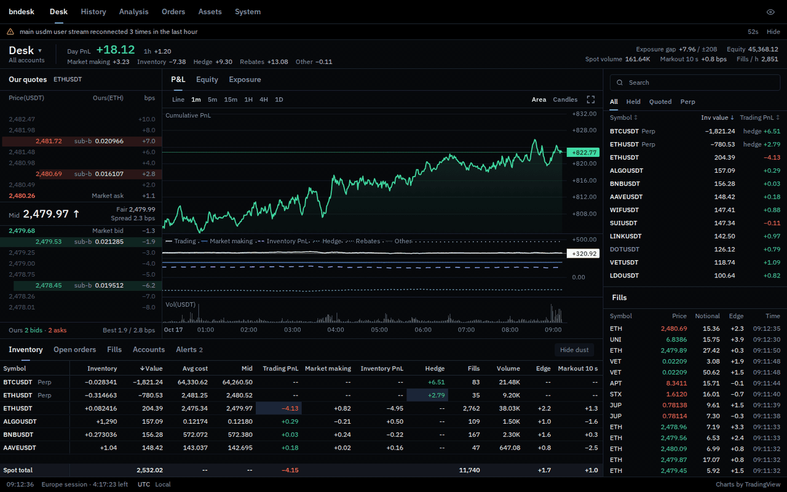
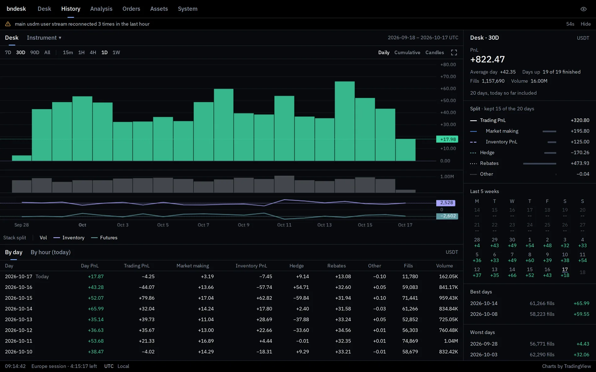
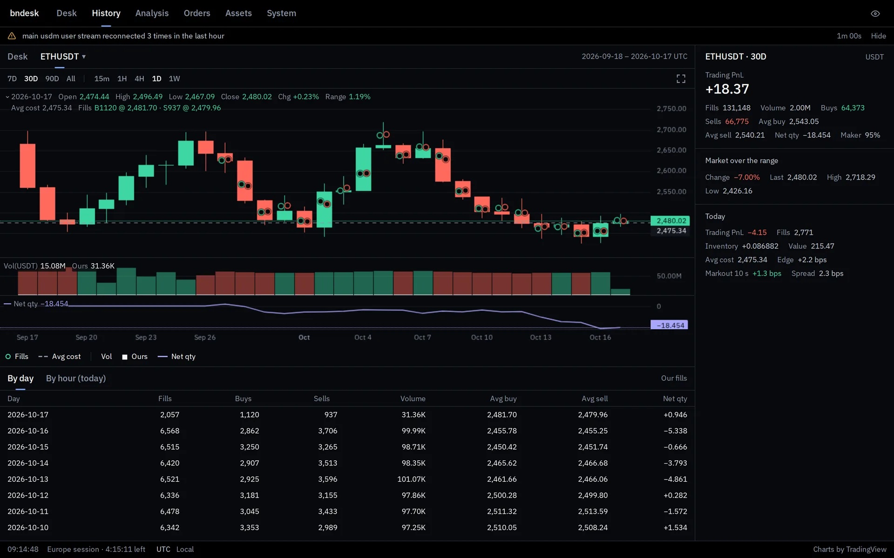
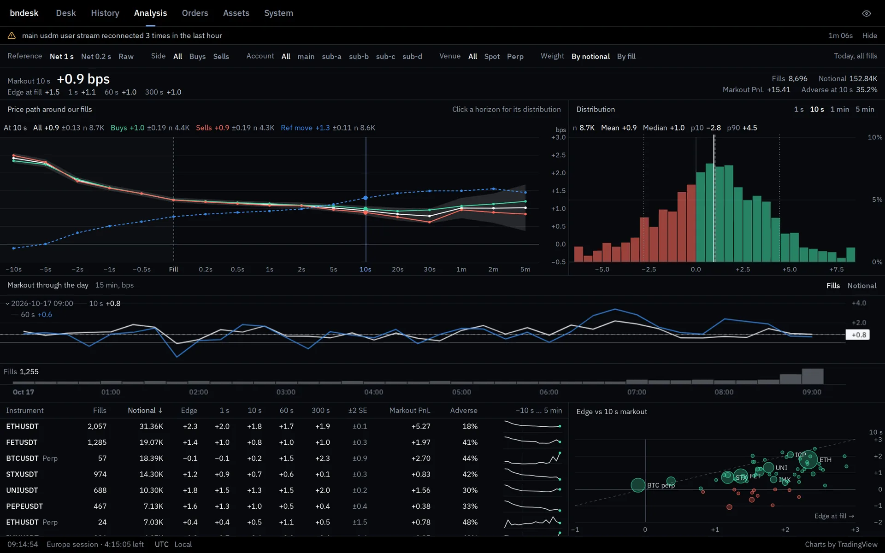
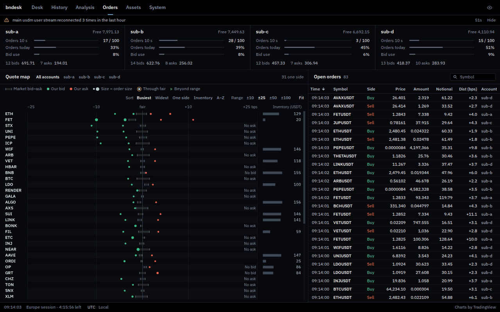
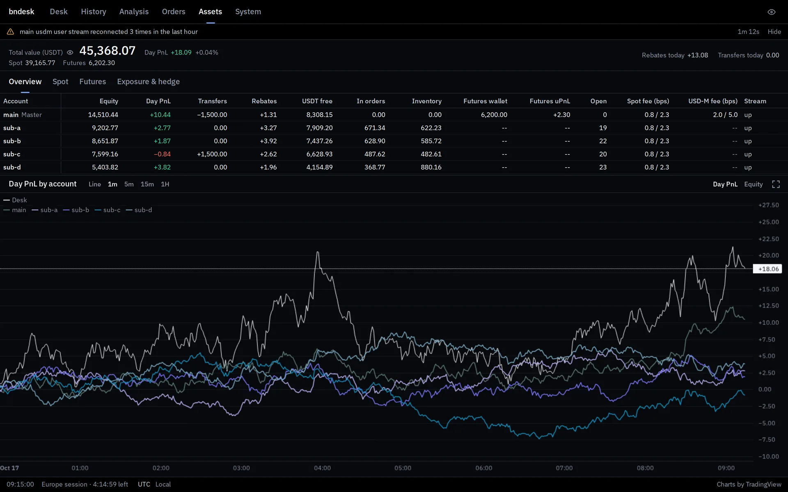
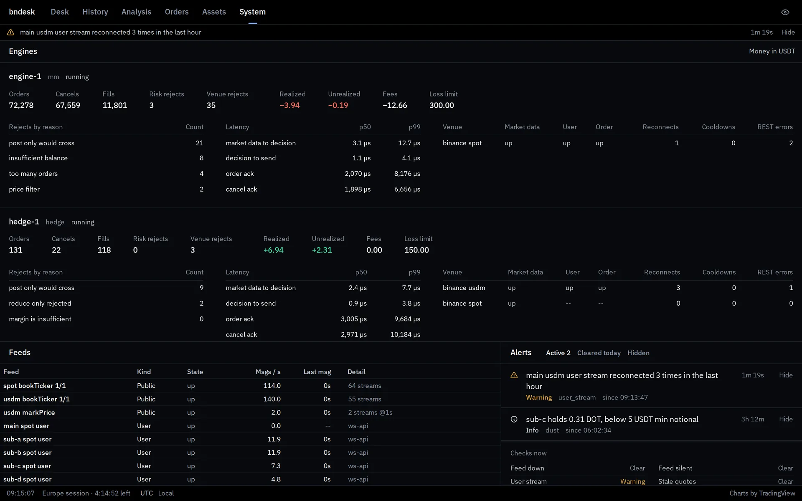
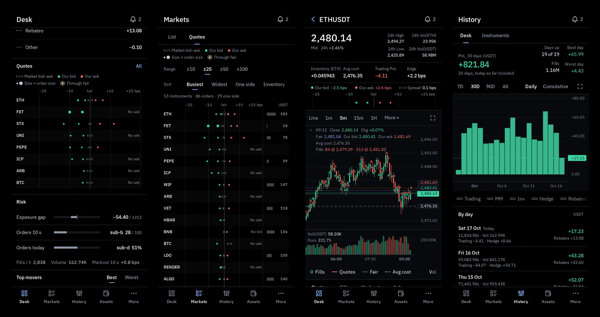
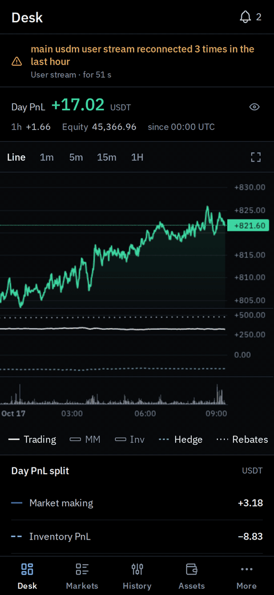

# The pages

Six pages run along the top: Desk, History, Analysis, Orders, Assets and System, on keys 1 to 6. A footer under every page gives the time, the trading session and the time zone, and speaks of the connection only when the data is stale or lost. The eye at the top right hides every money figure.

## Desk

The page you keep open, laid out like an exchange's trade page. Day P&L leads, with its parts in one line under it: market making, inventory, hedge, rebates and whatever those do not explain, so a gap in the books shows up as a number. The quote ladder on the left shows our orders between the market's bid and ask. The chart in the middle has P&L, Equity and Exposure tabs, intervals from 1 minute to 1 day, and pans back over earlier days, each day running on from the one before. On the right are the instruments and the latest fills; underneath, inventory, open orders, fills, accounts and alerts.

## History

Days, weeks or 15-minute bars of P&L for the whole desk, as daily bars, a cumulative line or candles, with volume, inventory and futures underneath. The right side has the range's total, its split, a calendar of the last five weeks and the best and worst days; the table splits each day the way the Desk splits today. A click on a day marks it and zooms to it.

Switched to one instrument, it shows Binance's klines with our fills on them, our average cost and net quantity, and our fills by day.

## Analysis

How the price moved around our fills, from 10 seconds before to 5 minutes after, for all fills, buys and sells, with ±2 standard-error bands and the reference's own move. Beside it, the distribution of markouts at a chosen horizon; under it, markouts through the day in 15-minute buckets, a table by instrument with each one's curve, and edge at the fill against the 10 s markout. Filters at the top choose the reference, side, account, venue and weighting.

## Orders

Each account's order rates against Binance's limits, then the quote map: every resting order against fair value and the market's bid and ask, sized by amount and sortable by activity, width, one-sided quotes or inventory. The open orders sit beside it. Picking an account narrows both.

## Assets

Total value and today's P&L, the accounts with their equity, transfers, rebates, free USDT and fees, and Day P&L or equity by account on one chart. Spot, Futures and Exposure & hedge have tabs of their own.

## System

The trading engines' own metrics, scraped from a Prometheus endpoint: orders, cancels, fills, rejects by reason, latency and their venue connections. Under them, the desk's market and user data feeds and the alerts, active, cleared today and hidden.

Old links still land: `#/markouts`, `#/accounts` and `#/engine` open Analysis, Assets and System.

## On a phone

A phone gets a layout of its own, made for checking on the desk rather than watching it. Five tabs run along the bottom: Desk, Markets, History, Assets and More. Alerts are under the bell at the top. Analysis, Orders, System and all of the day's fills are under More, along with the time zone and Hide amounts.

The Desk leads with Day P&L and its chart, then the split, a small quote map of the busiest instruments, risk against its limits, the day's top movers and the latest fills. Markets lists every instrument with its mid, 24 h change and our P&L, or shows the full quote map. An instrument has its price, our figures, a live band of our quotes, klines with our fills and quotes on them, and tabs for quotes, fills, markouts and Binance's own figures. History shows the desk or one instrument by day.

Each screen has its own link, such as `#/alert/<id>`, `#/instrument/BTCUSDT/spot`, `#/markets/quotes` or `#/day/2026-10-15`, so a link from an alert opens the right place, and Back works as in an app. The desk can be added to the home screen, where it opens without the browser's bars.
