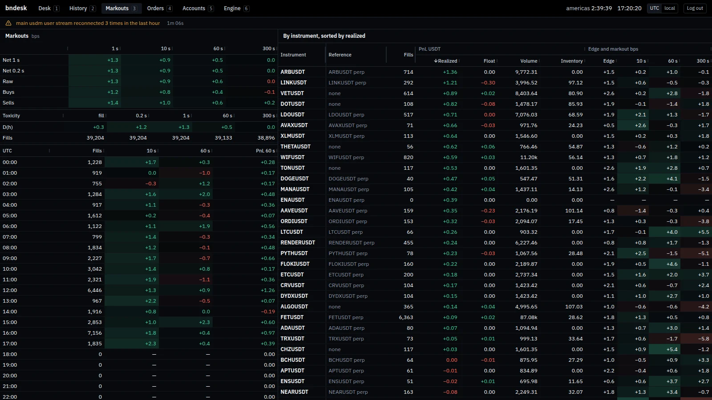
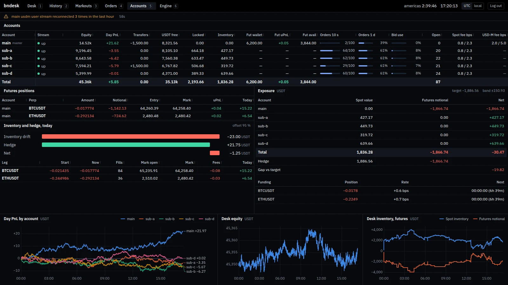
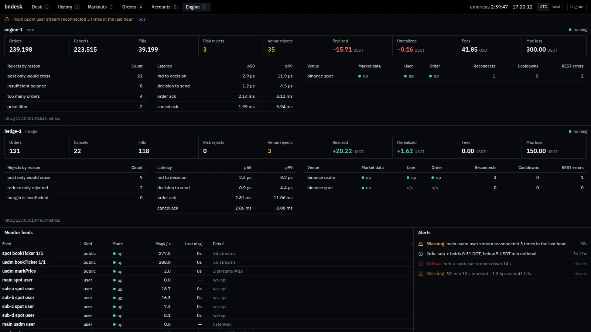

# The pages

## Desk

The page you keep open. Day P&L is split into market making, inventory, hedge and whatever those three do not explain, so a gap in the books shows up as a number. Below it are the day chart, the instruments you hold or quote, the latest fills and the accounts.

## History

Days and weeks of P&L as candles, with volume and inventory underneath and a table that splits each day the way the Desk splits today.

Switched to one instrument, it shows the market's klines with your fills on them.

## Markouts

How the price moved after your fills, how much of the edge survived, and which hours and markets did well.

## Orders

Your resting quotes against fair value and the market's bid and ask, next to each account's order-rate usage.

## Accounts

Balances, futures positions, the exposure and the hedge.

## Engine

Your trading engine's own metrics, scraped from a Prometheus endpoint, along with the desk's connections and alerts.

## On a phone

A phone gets a layout of its own, made for checking on the desk rather than watching it. Five tabs run along the bottom: Desk, Alerts, Accounts, History and More. Markouts, Orders, Engine and all of the day's fills are under More, along with the time zone and Hide amounts, which masks every USD figure.

The Desk leads with active alerts, then Day P&L and its split, the exposure gap and order rates against their limits, the best and worst instruments of the day, the accounts, the day chart and the latest fills. Grids become lists: a tap on a row opens that instrument, account, day or alert. There is no quote map; Orders lists the open orders instead.

Hover does not exist on a phone, so a label with a dotted underline opens its definition when tapped. The connection state is always in the top corner, and when the data goes stale the figures dim and the time of the last update shows.

Each screen has its own link, such as `#/alert/<id>`, `#/instrument/BTCUSDT/spot` or `#/day/2026-10-15`, so a link from an alert opens the right place, and Back works as in an app. The desk can be added to the home screen, where it opens without the browser's bars.
